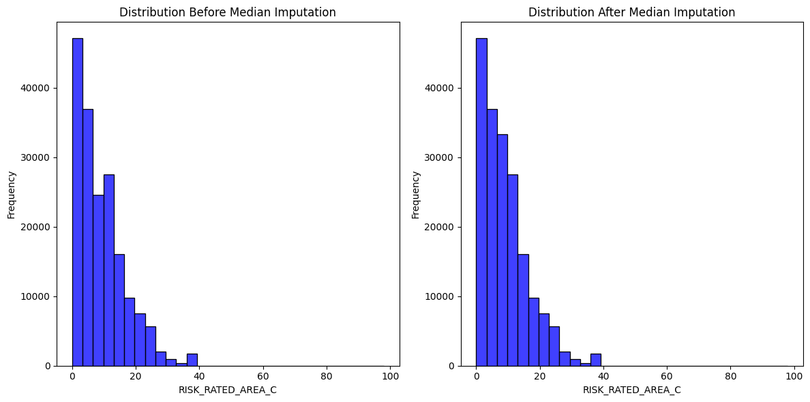
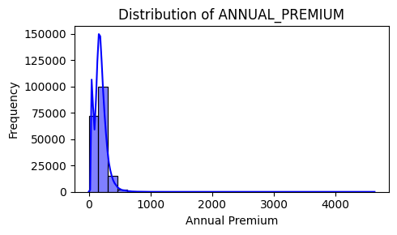
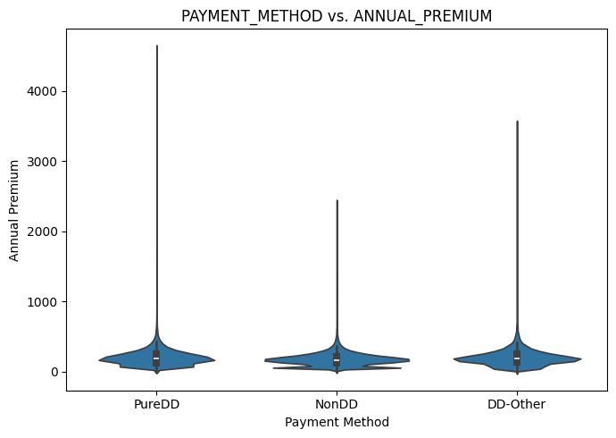
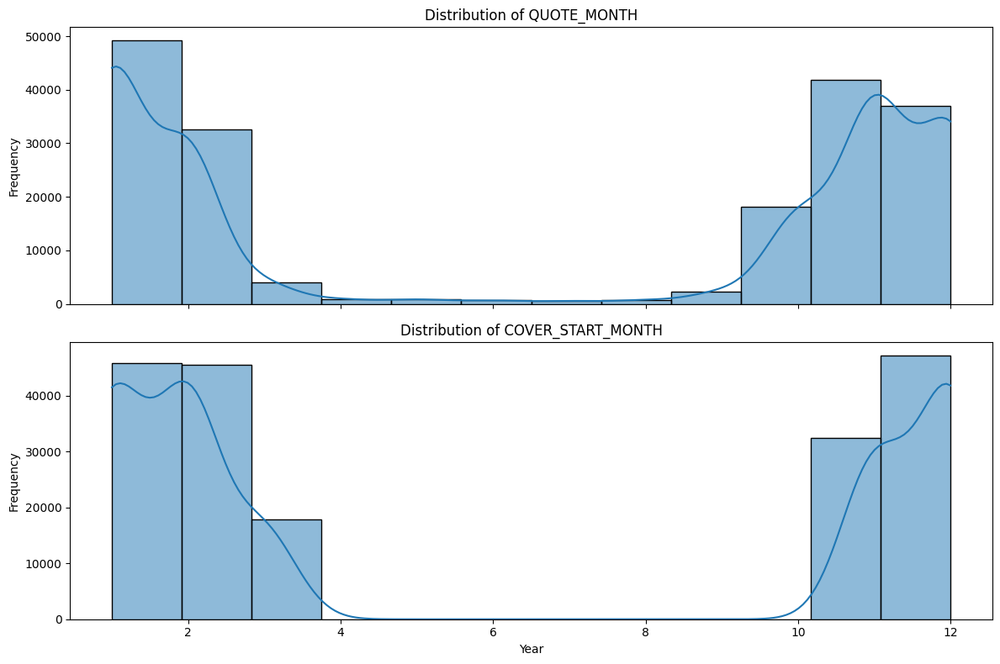
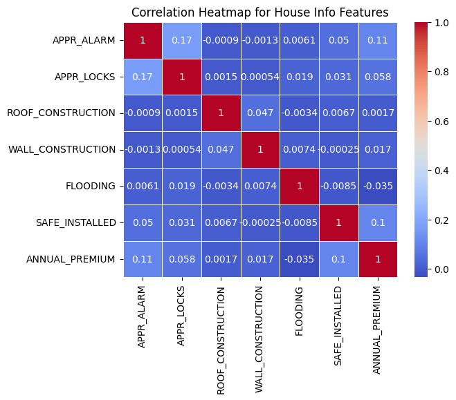

# Home Insurance Premium Prediction

An end-to-end machine learning project that predicts the **annual premium** of home insurance policies from property, coverage, security and customer features. It covers data cleaning, feature engineering, EDA and regression modelling on **~256,000 policy records**.

## Objective

Predict `ANNUAL_PREMIUM` for a home insurance policy and understand which factors influence pricing.

## Dataset

- **Size:** 256,136 rows × 42 columns (188,988 rows × 45 columns after cleaning and feature engineering)
- **Source:** `ADD_YOUR_DATASET_SOURCE_HERE` (name and link the public source, e.g. Kaggle)
- **Target:** `ANNUAL_PREMIUM`
- Full column descriptions are in [`Dataset_Features.txt`](Dataset_Features.txt).

| Group | Example features |
|---|---|
| Policy and dates | `QUOTE_DATE`, `COVER_START`, `PAYMENT_METHOD`, `PAYMENT_FREQUENCY` |
| Coverage | `BUILDINGS_COVER`, `CONTENTS_COVER`, `SUM_INSURED_BUILDINGS`, `AD_BUILDINGS`, `AD_CONTENTS`, `SPEC_SUM_INSURED` |
| Risk | `RISK_RATED_AREA_B/C`, `NCD_GRANTED_YEARS_B/C`, `FLOODING`, `SUBSIDENCE` |
| Security | `APPR_ALARM`, `APPR_LOCKS`, `SAFE_INSTALLED`, `NEIGH_WATCH`, `SEC_DISC_REQ` |
| Property | `PROP_TYPE`, `BEDROOMS`, `YEARBUILT`, `ROOF_CONSTRUCTION`, `WALL_CONSTRUCTION`, `LISTED`, `MAX_DAYS_UNOCC` |
| Customer | `P1_EMP_STATUS`, `P1_MAR_STATUS`, `P1_GENDER`, `P1_DOB`, `OCC_STATUS` |

## Workflow

### 1. Data cleaning
- Parsed dates held in mixed formats (`dd/mm/yyyy`, `dd-mm-yyyy`, `mm-dd-yyyy`) into proper datetimes.
- Found that **67,115 rows were missing** across a shared set of columns (policy, coverage and customer fields). Since the entire record was blank, these rows were dropped.
- Imputed `RISK_RATED_AREA_B` and `RISK_RATED_AREA_C` with the **median**, and compared the distributions before and after.
- Filled missing `QUOTE_DATE` values by forward fill.
- Removed policies with `ANNUAL_PREMIUM <= 0`.

```python 

df['YEARBUILT'] = pd.to_datetime(df['YEARBUILT'], format='%Y')
date_formats = ['%d/%m/%Y', '%d-%m-%Y']
def convert_to_datetime(date_str):
    for fmt in date_formats:
        try:
            return pd.to_datetime(date_str, format=fmt)
        except ValueError:
            pass

df['P1_DOB'] = df['P1_DOB'].apply(convert_to_datetime)
df['COVER_START'] = df['COVER_START'].apply(convert_to_datetime)
df['QUOTE_DATE'] = df['QUOTE_DATE'].astype(str).str.strip().str.replace('/', '-')
df['QUOTE_DATE'] = pd.to_datetime(df['QUOTE_DATE'], format='%m-%d-%Y')

median_risk_b = df['RISK_RATED_AREA_B'].median()
df['RISK_RATED_AREA_B'].fillna(median_risk_b, inplace=True)

median_risk_C = df['RISK_RATED_AREA_C'].median()
df['RISK_RATED_AREA_C'].fillna(median_risk_C, inplace=True)


```
### 2. Feature engineering
- `AGE`: client age at the start of cover
- `PROPERTY_AGE`: age of the property at the start of cover
- Extracted year and month from `QUOTE_DATE` and `COVER_START`
- Converted `Y/N` flags to `1/0`
- One-hot encoded occupancy, employment, marital status, gender and payment method
- Standardised numeric features with `StandardScaler`

```python 


df['AGE'] = ((df['COVER_START'] - df['P1_DOB']) / pd.Timedelta(days = 365.25)).astype(int)
df['PROPERTY_AGE'] = ((df['COVER_START'] - df['YEARBUILT']).dt.days // 365)
print(df[['P1_DOB', 'COVER_START', 'YEARBUILT', 'AGE', 'PROPERTY_AGE']])

df['QUOTE_YEAR'] = df['QUOTE_DATE'].dt.year
df['QUOTE_MONTH'] = df['QUOTE_DATE'].dt.month
df['COVER_START_YEAR'] = df['COVER_START'].dt.year
df['COVER_START_MONTH'] = df['COVER_START'].dt.month

# Drop original date columns
df = df.drop(['QUOTE_DATE', 'COVER_START'], axis=1)
df = df.drop(['P1_DOB'], axis=1)

df['Year_of_Construction'] = df['YEARBUILT'].dt.year
df = df.drop('YEARBUILT', axis=1)

cols_to_replace = ['BUS_USE', 'AD_BUILDINGS', 'AD_CONTENTS', 'CONTENTS_COVER', 'BUILDINGS_COVER',
                   'P1_POLICY_REFUSED', 'APPR_ALARM', 'APPR_LOCKS', 'FLOODING', 'NEIGH_WATCH',
                   'SAFE_INSTALLED', 'SEC_DISC_REQ', 'SUBSIDENCE']

df[cols_to_replace]= df[cols_to_replace].replace({'Y': 1, 'N': 0})

```
Let's see the effect of Median Imputation on the distribution 
* Before and After the Imputation (Area_B)

* Before and After the Imputation (Area_C)


The reason we do median imputation to fill missing values in numeric data when the distribution is skewed or contains outliers.

### 3. Exploratory data analysis
- **Univariate:** premium distribution, employment status, gender, payment method, construction year, quote and cover-start months

```python

fig, axes = plt.subplots(nrows=1, ncols=1, figsize=(5, 3))
sns.histplot(df['ANNUAL_PREMIUM'], ax=axes, bins = 30, kde = True, color = 'blue')
axes.set_title('Distribution of ANNUAL_PREMIUM')
axes.set_xlabel('Annual Premium')
axes.set_ylabel('Frequency')


plt.tight_layout()
plt.show()

```



- **Bivariate:** payment method vs. premium (violin), age vs. premium (regression), property age vs. premium, payment method vs. payment frequency

```Python

fig, ax = plt.subplots(figsize=(7, 5))

# Violin plot for PAYMENT_METHOD vs. ANNUAL_PREMIUM
sns.violinplot(x='PAYMENT_METHOD', y='ANNUAL_PREMIUM', data=df, ax=ax)
ax.set_title('PAYMENT_METHOD vs. ANNUAL_PREMIUM')
ax.set_xlabel('Payment Method')
ax.set_ylabel('Annual Premium')

# Adjust layout
plt.tight_layout()
plt.show()

```


- **Multivariate:** correlation heatmap of security and construction features against premium

```Python

house_info_corr = df[['APPR_ALARM', 'APPR_LOCKS', 'ROOF_CONSTRUCTION', 'WALL_CONSTRUCTION', 'FLOODING', 'SAFE_INSTALLED', 'ANNUAL_PREMIUM']].corr()
sns.heatmap(house_info_corr, annot=True, cmap='coolwarm', linewidths=.5)
plt.title('Correlation Heatmap for House Info Features')
plt.show()

```


### 4. Modelling
80/20 train-test split (`random_state=42`).

| Model | Test R² | Notes |
|---|---|---|
| Decision Tree | 0.452 | MAE ≈ 45.9, RMSE ≈ 74.7. Train R² ≈ 1.00, so it clearly **overfits** |
| Linear Regression | **0.593** | Best result so far |
| SVR, Gradient Boosting, Random Forest, XGBoost, LightGBM | In progress | Code is written, results not yet recorded |


```Python

from sklearn.model_selection import train_test_split
x_train, x_test, y_train, y_test = train_test_split(x,y,train_size=0.8, random_state = 42)

from sklearn.tree import DecisionTreeRegressor
model = DecisionTreeRegressor(random_state=42)
model.fit(x_train, y_train)
y_test_pred = model.predict(x_test)

from sklearn.metrics import mean_absolute_error, mean_squared_error, r2_score, root_mean_squared_error
mae = mean_absolute_error(y_test, y_test_pred)
mse = mean_squared_error(y_test, y_test_pred)
rmse = root_mean_squared_error(y_test, y_test_pred)
r2 = r2_score(y_test, y_test_pred)

```
**Takeaway:** the simple linear model generalised better than the unconstrained decision tree. Tree-based models need regularisation (depth limits, ensembling) to beat it.

## Tech stack

Python · pandas · NumPy · Matplotlib · Seaborn · scikit-learn · XGBoost · LightGBM · Jupyter Notebook


## Project structure

```
.
├── Property_insurance_premium.ipynb   # Cleaning, EDA and modelling
├── Dataset_Features.txt               # Column descriptions
├── home_insurance_dataset.csv         # Dataset 
|
|- Images/ 
|
source above)
└── README.md
```

## Next steps

- Finish evaluating Random Forest, Gradient Boosting, XGBoost and LightGBM and compare all models in one table
- Tune hyperparameters with cross-validation (`GridSearchCV` / `RandomizedSearchCV`)
- Predict on a log-transformed premium, since the target is likely right-skewed
- Add feature-importance and SHAP analysis
- Fit the scaler and encoders on the training set only, using a scikit-learn `Pipeline`
- Add outlier handling

## Author

Tajveer Singh